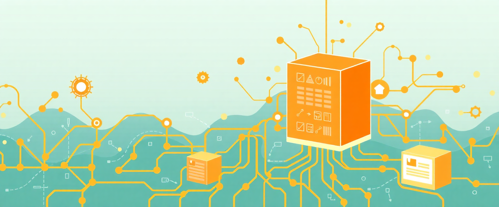
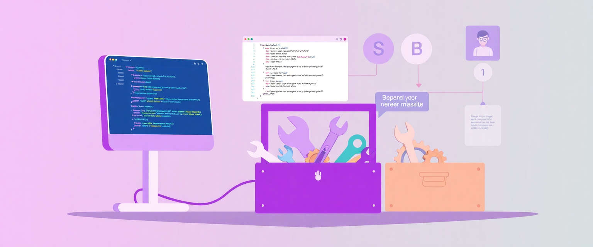
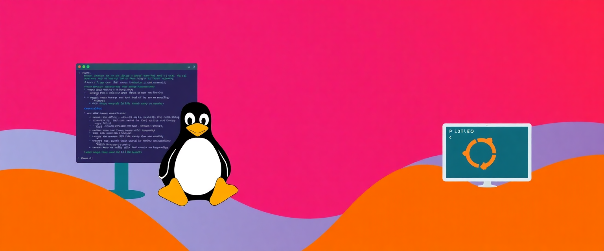
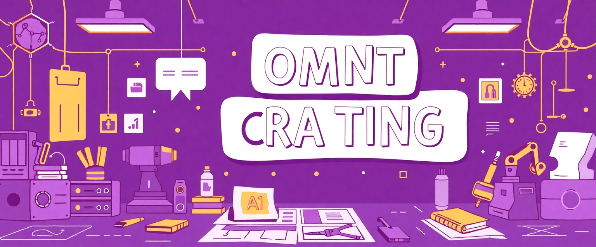
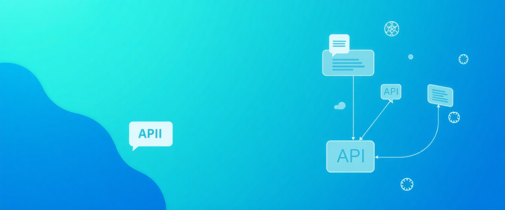
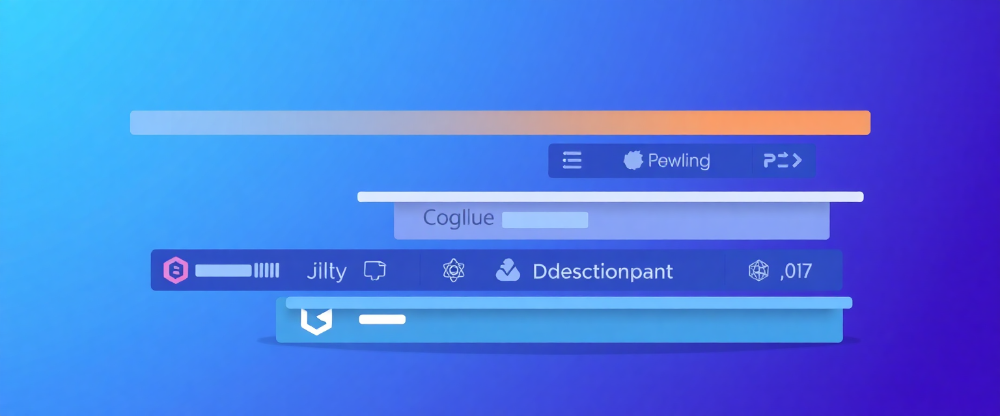

Note: links are to my [docs website](https://docs.bydanielrosehill.com) which pulls its content from the repositories shared here.

# Documentation Repositories, Index

I use [Github](htttps://github.com/danielrosehill) as a notepad to share documentation, notes, and experiments.

Recently, I set up a website to house it:

**Last Updated:** October 2026

---

## Table of Contents

- [AI & LLMs](#ai--llms)
- [Context & RAG (AI)](#context--rag-ai)
- [Backup & Data Management](#backup--data-management)
- [Claude & Anthropic](#claude--anthropic)
- [Data & Research](#data--research)
- [Development Tools & Workflows](#development-tools--workflows)
- [GitHub](#github)
- [Home Automation & Hardware](#home-automation--hardware)
- [Ideas & Concepts](#ideas--concepts)
- [Israel-Specific](#israel-specific)
- [Linux & Desktop](#linux--desktop)
- [MCP (Model Context Protocol)](#mcp-model-context-protocol)
- [Miscellaneous](#miscellaneous)
- [Personal & Career](#personal--career)
- [Prompts & Prompt Engineering](#prompts--prompt-engineering)
- [Software & APIs](#software--apis)
- [Speech & Voice](#speech--voice)
- [Tech Stack & Tools](#tech-stack--tools)
- [Other Documentation & Publishing Projects](#other-documentation--publishing-projects)
- [Other Sites](#other-sites)

---

## AI & LLMs

### Agentic AI Architecture Visualisation

Framework-agnostic data model and visualizations mapping the moving pieces of agentic AI systems

---

### AI Native Backend Notes

Questions and answers with Claude on building AI native backends

---

### Shared AI Chats Research

AI assisted search query (and notes)

---

### AI Agent UN

AI Agent UN concept and notes

---

### AI Developer Notebook

AI developer notebook and notes

---

### AI Friendly Badge

Idea and badge - AI friendly footer

---

### AI Human Attribution Adder

Tool for adding AI/human attribution to content

---

### AI Workspace Planning Notes

AI workspace planning notes and documentation

---

### AMD AI Notes

Notes on AMD AI/ML setup, ROCm, and related configurations

---

### API Pricing / Cost Management

API Pricing / Cost Management documentation

---

### Custom Agent Configurations

Custom Agent Configurations documentation

---

### Hebrew LLMs

Hebrew Language LLMs

---

### Just Some AI App Ideas

Just Some AI App Ideas

---

### LLM & Prompt Engineering Workflow

LLM & Prompt Engineering Workflow documentation

---

### LLM API Price Estimates

LLM API Price Estimates

---

### LLM Attribution Badges

LLM Attribution Badges

---

### LLM Experiment Notebook

LLM Experiment Notebook

---

### LLM Knowledge Management Project

LLM Knowledge Management Project documentation

---

### LLM Max Token Length 0225

LLM Max Token Length 0225

---

### LLM Preferences Guide

LLM Preferences Guide

---

### LLM Use Case Self Ideation

LLM Use Case Self Ideation

---

### LLMs on LLMs

LLMs on LLMs documentation

---

### Local Linux Repair Bot

Local Linux repair bot documentation

---

### Long AI Prompting Experiment

Long AI Prompting Experiment

---

### AI Stack Oct 2025

Model AI stack and budget (Oct 2025) - for ref, FAQs, etc

---

### My LLM KM Idea

Knowledge management system concept for storing and organizing LLM outputs (prompts, responses, configs)

---

### Perplexity Security 1224

Perplexity Security 1224

---

### Personalised AI Idea

Personalised AI idea notes and documentation

---

### Use-Case Self-Ideation

Use-Case Self-Ideation documentation

---

### Vibe Code And Learn

Model for using code gen assistants as code tutors that also code stuff

---

### Vibe Coded Disclosure

Add a vibe coding disclosure to repos

---

## Context & RAG (AI)

### Context Waterfall Architecture Notes

Context Waterfall Architecture Notes

---

### Personal Context AI Agent Pattern Model

Personal context AI agent pattern model documentation

---

### Personal Context Store Ideation

Personal Context Store Ideation

---

### AI Memory Planning

Architecture diagrams and notes exploring three methods for building persistent AI context: passive chat distillation, agentic interviews, and manual memory curation

---

### Personal RAG Agent Workflow

Personal RAG Agent Workflow

---

## Backup & Data Management

### Back Up Your SaaS

Updated SaaS backup documentation and notes

---

### Desktop Backup Notes 1125

Desktop backup notes and documentation (Nov 2025)

---

### Master Backup Strategy

Master Backup Strategy

---

## Claude & Anthropic

### Claude Agent Picker Pattern

Claude agent picker pattern documentation

---

### Claude Code Context Feature Requests

Claude Code feature requests

---

### Claude OS Sync Agent

Idea - using Claude Code in place of Ansible for cross-device updating/sync

---

### Claude Rescue

WIP/Plan/Idea: System recovery/rescue utility that seeds Claude Code installation for AI-assisted repair from TTY/shell

---

### Claude Code Notes

Notebook for making the most of Claude Code

---

### Split Claude MD Pattern

Demo/pattern for creating a home CLAUDE.md optimised for context handling

---

### ClaudeMD Turnstile

Quick model/template for creating separate CLAUDE.md files for developers and users

---

## Data & Research

### Data Notebook

Data Notebook documentation

---

### GVFD Derivative Docs

GVFD Derivative Docs

---

### Useful ISO Standards Reference

Useful ISO standards

---

## Development Tools & Workflows

### Code Tutor Agent Model

Model for using code gen assistants as code tutors that also code stuff

---

### Docs Templates

Docs Templates documentation

---

### Obsidian AI Tools

Obsidian AI Tools documentation

---

### Prototypes

Prototypes

---

### Test Markdown Docs

Test Markdown Docs

---

## GitHub

### Github AI Searches

Curated collection of GitHub search links for exploring open-source AI projects (agents, assistants, MCP servers, etc.)

---

### Gists

Gists documentation

---

### Gists (GitHub)

Daniel's GitHub Gists collection

---

## Home Automation & Hardware

### Home Assistant Starter List

Home Assistant starter list

---

### USB Foot Mouse Linux

USB Foot Mouse Linux

---

### Workstation Specs

Workstation specs

---

### One Plus Nord 3 Root Guide

Guide to rooting OnePlus Nord 3 5G on OxygenOS 16 with Magisk

---

## Ideas & Concepts

### Agent Wiki Idea

Notes/prior-art for a wiki whose primary readers and writers are AI agents over MCP, not humans

---

### A Better Jobs Platform Notes

Notes on ideas for a better jobs platform

---

### Ideas

Ideas documentation

---

### Is Remote Friendly

Data taxonomy for categorizing remote work restrictions (geographic, timezone, requirements)

---

### Tech Ideas

Tech Ideas

---

## Israel-Specific

### Israel Home Front Ideas

A few open source ideas for the Pikud HaOref system collected over time

---

### Israel News RSS Feeds

Israel News RSS Feeds (List)

---

### Israel Red Alert Syntax Notes

IDF Home Front Command Red Alert syntax

---

### Israel Rocket Shelter Guidelines

Israel Rocket Shelter Guidelines

---

### Public Shelter Internet Setup

Makeshift DIY guide for getting internet into protected shelters in Israel

---

### Hebrew Tech Vocab

Personal WIP / collection of tech words

---

### Failover Internet Israel Notes

Notes on setting up failover internet in Israel

---

### The Jerusalem Odyssey Text

The Jerusalem Odyssey Text

---

## Linux & Desktop

### Network In A Box Planning

Claude generated tips for home network migration

---

### Voice Control Linux

Claude-enhanced research for voice control platforms with Linux support

---

### AMD Radeon 7700 Notes

Notes about AMD Radeon 7700 GPU and compatibility

---

### K811 EV Test Events

Input event documentation for K811 gaming keypad on Ubuntu (evtest output, mappings)

---

### Keyboard Shortcuts Ref

Keyboard Shortcuts / Ref

---

### KScreen Config Scripts And Docs

Kscreen Config

---

### Handy Ubuntu Setup

Handy Ubuntu setup guides and configuration notes

---

## MCP (Model Context Protocol)

### MCP Server Ideas

MCP Server ideas

---

### Sefaria MCP Testing

Sefaria MCP server testing and documentation

---

### How To MCP

Template for a guidance reference for AI agents configuring MCP connections

---

### MCP Aggregation Notes

Ideating/brainstorming frustrations with MCP aggregation and planning an easier approach

---

### MCP Deployment Architecture

Documentation of the two-tier MCP aggregation architecture — LAN VM as default, localhost for exceptions — with rationale around client portability, location flexibility, and context load management

---

### MCP Installation Notebook

Notebook of things figured out about installing MCPs

---

## Miscellaneous

### Changelog

Changelog documentation

---

### How To Guides

How To Guides

---

### Interesting Tech Things

Interesting Tech Things

---

### Wiki

Wiki

---

## Personal & Career

### AI Developers Career Planning Notes

Notes/ideas for the evolving face of programming jobs

---

### Career Data AI Context Repo

Career Data (sample context repo)

---

### Client Update Pipeline Notes

Client update pipeline notes and documentation

---

### Daniels Take On

Daniels Take On

---

### General Thoughts On Life

General Thoughts On Life documentation

---

### My Thoughts On Tech

My Thoughts On Tech

---

### Personal Dashboard Project

Personal Dashboard Project Notes

---

### Projects (List)

Projects (List) documentation

---

### Thoughts On Tech

Thoughts On Tech documentation

---

## Prompts & Prompt Engineering

### AI Dev Prompts Example

Example prompts and best practices for AI-assisted Python GUI development on Linux desktop

---

### Evaluation Prompts

Evaluation Prompts documentation

---

### Principles of Prompting

Principles of Prompting documentation

---

### Prompt Eng Resources

Prompt Eng Resources documentation

---

### Prompt Libraries (List Of)

Prompt Libraries (List Of) documentation

---

### Prompt Library

Prompt Library documentation

---

### Prompts And Outputs

Prompts And Outputs

---

## Software & APIs

### Deepgram Text Input

Deepgram text input tool/integration

---

### Gmail Search Strings

Gmail Search Strings

---

### Green Invoice API My Notes

Green Invoice API

---

### Nuclino API Docs (Unofficial) 0725

Nuclino API documentation snapshot (July 2025) with OpenAPI schemas

---

### Resource Space DAM Assets

Resource Space DAM assets and documentation

---

### Software Wish List AI Context

Software wish list for AI context purposes

---

## Speech & Voice

### ASR And STT AI Notebook

ASR and speech-to-text AI notebook and notes

---

### Linux Voice Typing App Notes

Linux voice typing app notes and documentation

---

### Live Typing UX Research

Claude-assisted technical research into live voice typing on the desktop — interaction patterns, accuracy tradeoffs, and a working spec for an ideal live-typing UI

---

### Speech To Text Chain Notes

Notes on the 9-step ASR processing chain components affecting speech recognition accuracy

---

### STT Fine Tune Project Outline

STT Fine Tune

---

### Voicepad

Planning notes for a macropad for STT users

---

### Hebrew TTS Providers

Point in time snapshot of TTS providers with Modern Hebrew support

---

## Tech Stack & Tools

### Tech Stack

Tech Stack documentation

---

### Tech Stack (Repo)

Tech Stack

---

# Other Documentation & Publishing Projects

## Daniel Goes Prompting (Prompts & Outputs Repository)

---

## Tech Blog (Personal)

---

## The LLM Files (Notes, Blogs)

---

# Other Sites

